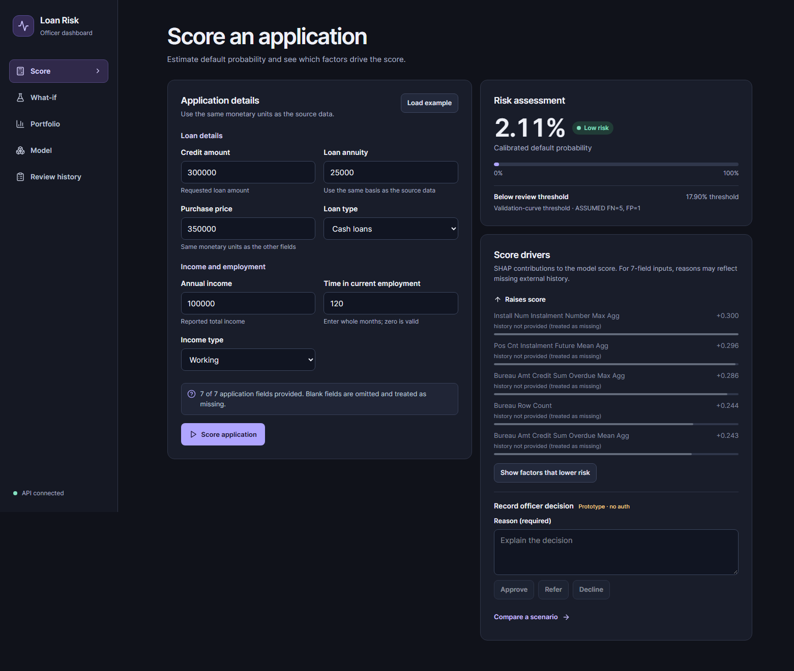
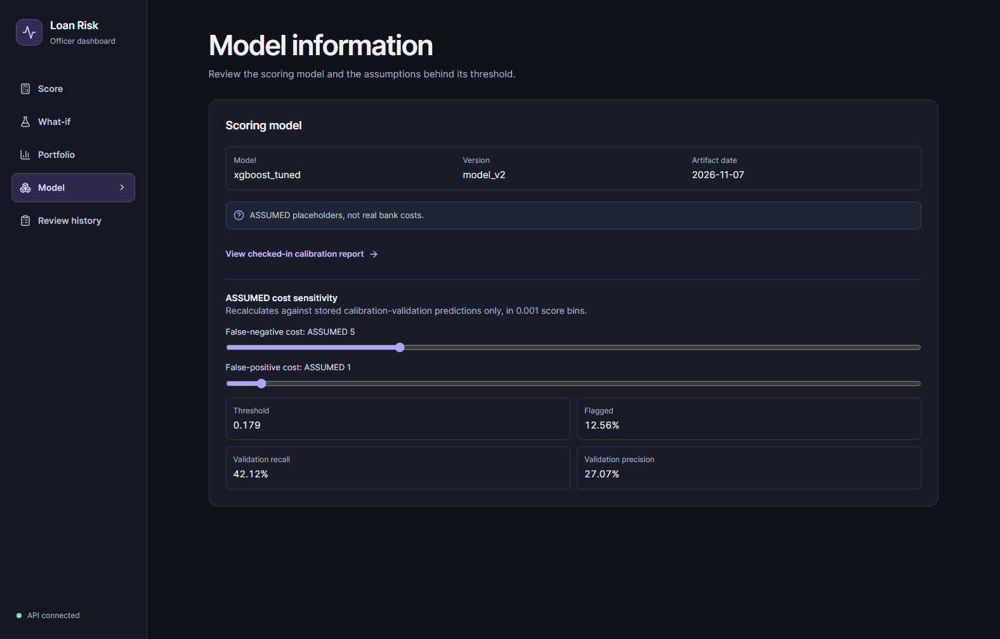

# Loan Default Prediction

A prototype for scoring Home Credit loan applications with a fitted machine-learning model.
It includes a FastAPI service and a React dashboard. It is an academic demonstration, not
a production credit-decision system.

## Status

| Capability | Status | What is present |
|---|---|---|
| Data pipeline and feature pipeline | Done | Source code and fitted transformers; running it requires the source dataset. |
| Calibrated XGBoost model | Done | Saved model with calibration; no retraining is performed by the app. |
| SHAP explanations | Done | Local feature attributions; associations are not causal. |
| FastAPI | Done | Health, scoring, explanations, simulation, model info, and portfolio summary endpoints. |
| Dashboard | Done | Scoring, what-if, portfolio, model, and review-history views. |
| Fairness and PSI audit | Done | Offline audit reports; PSI includes a simulated-shift demonstration, not live monitoring. |
| Docker and CI | Done | Docker Compose app and GitHub Actions Python/frontend checks. |
| Review log | Prototype | SQLite decision log; no authentication or reviewer identity. |
| Cost threshold analysis | Prototype | Score and Model use the same stored validation curve and ASSUMED default costs (FN=5, FP=1). |
| Applicant lookup | Prototype | Local-only held-out lookup; requires `data/processed/test.parquet`, excluded from Docker. |
| Authentication | Not implemented | No login or access control. |
| PostgreSQL | Not implemented | Review prototype uses SQLite only. |
| Early-warning alerts | Not implemented | No alerting or production drift monitoring. |
| Real cost data | Not implemented | False-negative and false-positive costs are assumptions, not lender data. |

## Screenshots





## Model results and limitations

The calibrated full-feature model's held-out AUC is **0.7819**; the reported AUC using
seven-field inputs is **0.7269**. The calibration report also records KS **0.432412** and
Brier score **0.067716**. These are results from one Home Credit split, not a guarantee of
future performance. See
[the calibration report](docs/calibration_report.md) and
[the model comparison](docs/model_comparison.md) for the recorded evaluation.

The Score tab and Model tab use the same aggregated calibration-validation curve, with
default ASSUMED costs FN=5 and FP=1. The Score tab uses the corresponding default threshold;
the Model tab recalculates it as the cost sliders move. Probabilities are grouped into
0.001-wide bins, and no applicant identifiers are stored in that curve.
Costs are placeholders, not observed lender costs. The portfolio screen shows precomputed aggregate test results
from `docs/portfolio_summary.json`; it does not read borrower-level test data at runtime.

Scores and explanations are decision-support demonstrations only. Model associations are
not causes, and the threshold must not be interpreted as a recommendation to approve,
decline, or manually review an application.

## Run locally

Use Python 3.12. Install the pinned dependencies and start the API:

```powershell
py -3.12 -m venv .venv
.\.venv\Scripts\python.exe -m pip install -r requirements.txt
.\.venv\Scripts\python.exe -m uvicorn backend.main:app --host 0.0.0.0 --port 8000
```

In another terminal, start the frontend:

```powershell
cd frontend
npm ci
npm run dev
```

The Vite development server proxies `/api` requests to `http://127.0.0.1:8000`. Open the
URL printed by Vite. Model serving uses the committed model and transformer artifacts;
it does not require `data/raw` or processed parquet files.

Check the API and submit the seven-field sample:

```powershell
curl.exe http://localhost:8000/health
$payload = @'
{"AMT_CREDIT":300000,"AMT_INCOME_TOTAL":100000,"AMT_ANNUITY":25000,"AMT_GOODS_PRICE":350000,"DAYS_EMPLOYED":-3653,"NAME_CONTRACT_TYPE":"Cash loans","NAME_INCOME_TYPE":"Working"}
'@
$payload | curl.exe -X POST http://localhost:8000/predict -H "Content-Type: application/json" --data-binary "@-"
```

`DAYS_EMPLOYED` is elapsed days and is normally negative for employed applicants.
`/application-options` lists accepted loan and income categories. Optional request fields
may be omitted.

## Run with Docker Compose

Docker Desktop with Compose is required. Optionally copy `.env.example` to `.env` to
override the host ports; the example contains no credentials.

```powershell
docker compose up --build
```

The backend is available at `http://localhost:8000` and the dashboard at
`http://localhost:8080`. Nginx serves the frontend and proxies `/api/` to the backend.
The backend image runs as a non-root user and has a `/health` container health check.
Review history is persisted in a Compose-managed SQLite volume. Applicant lookup is local
demo-only and returns 404 in Docker because held-out parquet data is not copied or mounted
into the image.

## Tests and CI

```powershell
.\.venv\Scripts\python.exe -m pytest -q
```

The tests use synthetic fixtures and the committed model artifacts; they do not require
raw or processed data files. GitHub Actions runs the Python tests and builds the frontend
with `npm ci` and `npm run build`.

## Optional data pipeline

To run preprocessing and feature generation, place the Home Credit
`application_train.csv` at `data/application_train.csv`, install the requirements above,
and run:

```powershell
.\.venv\Scripts\python.exe -m src.data.run
```

This writes borrower-level intermediate data under the ignored `data/` directory. Do not
commit raw datasets, processed parquet files, or other borrower-level records. Only the
fitted `preprocessor.joblib` and `feature_pipeline.joblib` are tracked for serving.
Optional external-table aggregation scripts require their corresponding source files.
The aggregate validation threshold curve can be regenerated without fitting a model:

```powershell
.\.venv\Scripts\python.exe -m scripts.build_validation_threshold_curve
```

For the local-only lookup demo, keep the generated `data/processed/test.parquet` in place
and request `/lookup/{SK_ID_CURR}`. This endpoint reads that held-out file locally and
returns the saved model's probability and SHAP explanations.

## Repository map

- `backend/`: FastAPI application and scoring service
- `frontend/`: React/Vite dashboard and production nginx configuration
- `src/`: data, feature, and model code
- `models/`: saved scoring models
- `data/processed/`: only the two fitted transformer artifacts are tracked
- `docs/`: reports and the static portfolio summary
- `tests/`: API, model, data, and feature tests

See the [project synopsis](Team36_ProjectSynopsis.pdf), [EDA report](docs/EDA_report.md),
and [feature report](docs/feature_report.md) for additional project context.
